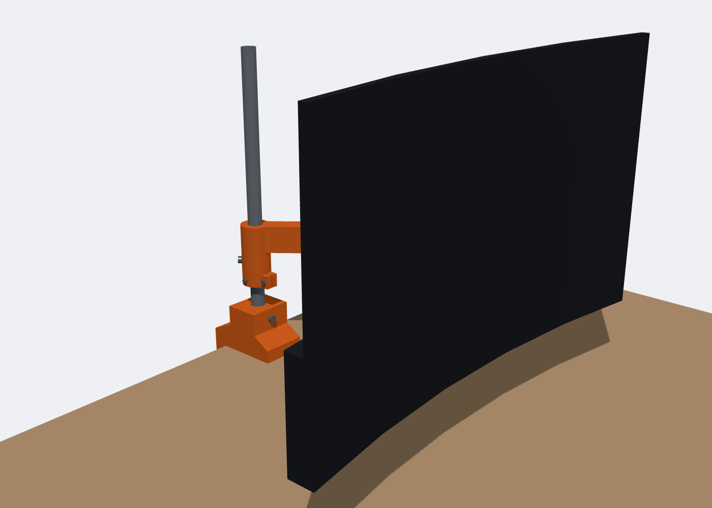
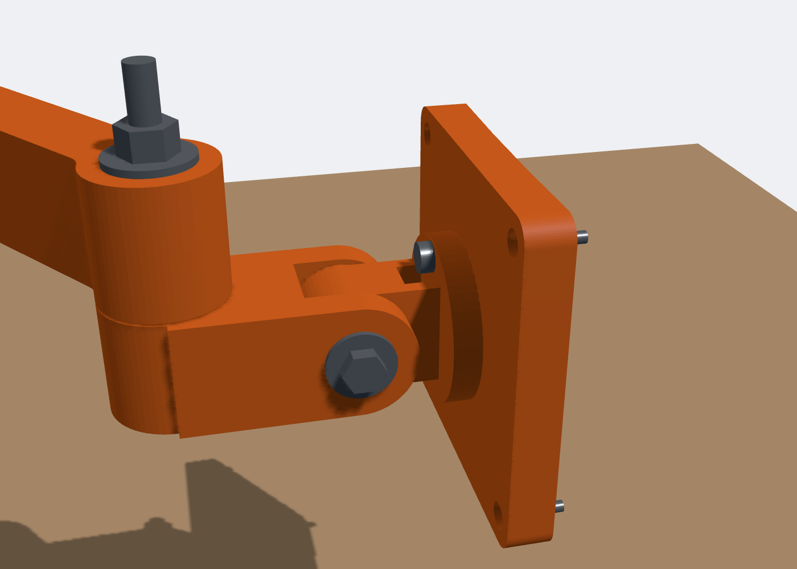
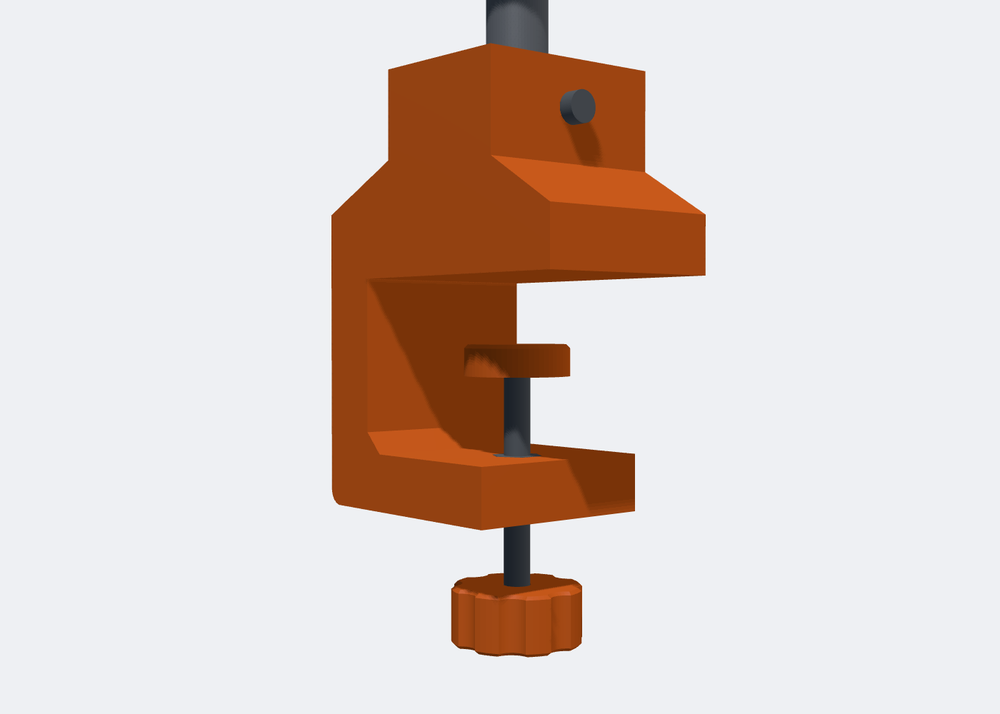

# Monitor Arm for the Sceptre C32 (C325B-185RD1)



A desk-clamped, 3D-printed monitor arm built for the **Sceptre C32 240 Hz curved monitor (model C325B-185RD1)**. It bolts straight onto the four M4 inserts on the back of the monitor and holds its 5.26 kg (11.6 lb).

The joints and links are printed in PETG. The parts that carry the most load are steel off the shelf: a ¾" pipe pole, M10 pivot bolts and an M8 tilt bolt. The whole build comes to about **$66 including tax**. Every part and its price is listed in the parts table below.

## What it does

| Motion | How it works | Range |
|---|---|---|
| Height | Stop collar pinned to the pole with a ¼" bolt through a drilled hole | Screen bottom 72–348 mm above the desk (the stock stand sits it at ~107 mm) |
| Swivel and reach | Two links (230 mm and 200 mm) on vertical M10 pivots | 0–546 mm out from the pole, folds ±150° |
| Pan | Head yoke on a vertical M10 pivot | ±90° |
| Tilt | M8 friction joint, preloaded with 3 disc springs | −10° to +20°. Keep forward tilt within 5° |
| Rotate | M8 centre bolt with an M5 detent screw | 0 / 90 / 180 / 270° (portrait needs the collar set high) |

### Why it mounts this way

This monitor has no flat VESA pad. Instead it has four **M4 threaded inserts in a 100 × 100 mm square**, set into the curved back of the lower housing around the stand's neck slot. The bracket (`vesa_bracket`) is curved on its front face to match the 1800R back, so it sits flat across the housing instead of rocking on the middle. It also has a shallow pocket so the rim of the neck slot doesn't hold it off. It uses the same **M4 × 12 pan-head screws** as the stand's neck, and those reach 7 mm into the inserts without bottoming out.

## Files

```
step/monitor_arm_assembly.step   the whole arm: every printed part, the pipe, every bolt/nut/washer
                                 (grey hw_* parts) and a stand-in monitor. Opens in Fusion, Onshape,
                                 FreeCAD, SolidWorks
step/*.step                      each printed part on its own
stl/*.stl                        print-ready meshes
src/monitor_arm.py               parametric CadQuery source (all dimensions at the top)
src/verify.py                    collision sweep across 18 arm positions + monitor fit checks
src/calcs.py                     hand strength calculations
renders/                         pictures
```

To regenerate the files: `pip install cadquery`, then `MONITOR_POLE=pipe python3 src/monitor_arm.py`.

## Parts and cost

Prices were checked on Oct 17–18, 2026. Amazon prices assume Prime, and AliExpress prices change often, so check each total before you pay.

| # | Item | Store | Qty to buy | Used for | Price |
|---|---|---|---|---|---|
| 1 | [JAYO PETG filament, black, 1.75 mm, 1.1 kg](https://www.amazon.com/dp/B0DCZ9ZLP9) | Amazon | 1 | Printed parts | $9.99 |
| 2 | [eono PETG filament, black, 1.75 mm, 1 kg](https://www.amazon.com/dp/B0G2BQQ5RT) (limit 1 per customer) | Amazon | 1 | Printed parts | $9.99 |
| 3 | [¾" × 1.5 ft black steel pipe, schedule 40](https://www.homedepot.com/p/VPC-3-4-in-x-1-5-ft-Black-Steel-Schedule-40-Cut-Pipe-21-707518/304751767) | Home Depot | 1 | Pole (comes pre-cut, no sawing) | $8.74 |
| 4 | [¼"-20 × 2½" hex bolt](https://www.homedepot.com/p/Everbilt-1-4-in-20-x-2-1-2-in-Zinc-Plated-Hex-Bolt-800626/204633263) | Home Depot | 1 | Collar cross pin | $0.39 |
| 5 | [¼"-20 hex nut](https://www.homedepot.com/p/Everbilt-1-4-in-20-Zinc-Plated-Hex-Nut-801736/204647886) | Home Depot | 1 | Cross pin nut | $0.14 |
| 6 | [M5 × 20 mm pan-head screw, 4-pack](https://www.homedepot.com/p/Everbilt-M5-0-8-x-20mm-Zinc-Pan-Head-Phillips-Drive-Machine-Screw-4-Pieces-836541/321071579) | Home Depot | 1 pack | Rotation detent | $1.95 |
| 7 | [M6 × 25 mm pan-head screw, 4-pack](https://www.homedepot.com/p/Everbilt-M6-1-0-x-25mm-Zinc-Pan-Head-Phillips-Drive-Machine-Screw-4-Pieces-836721/321071584) | Home Depot | 1 pack | Pole lock screw, swivel drag screw | $1.95 |
| 8 | [⅜" × 1½" fender washer](https://www.homedepot.com/p/Everbilt-3-8-in-x-1-1-2-in-Zinc-Plated-Fender-Washer-804816/204632769) | Home Depot | 4 | Both M10 pivots | $1.40 |
| 9 | [5/16" × 1½" fender washer](https://www.homedepot.com/p/Everbilt-5-16-in-x-1-1-2-in-Zinc-Plated-Fender-Washer-804806/204632770) | Home Depot | 2 | M8 tilt bolt | $0.58 |
| 10 | [Disc springs 16 × 8.2 × 0.9 mm, 12 pcs](https://www.aliexpress.us/item/3256806536117647.html) (option: 16x8.2x0.9 Silver) | AliExpress | 1 pack | Tilt preload (uses 3) | $1.09 |
| 11 | [M4 × 12 mm pan-head screws, 10 pcs](https://www.aliexpress.us/item/3256807033160325.html) (option: 12mm / M4 x 10Pcs) | AliExpress | 1 pack | Monitor screws (2 more to go with the stand's 2) | $1.42 |
| 12 | [M8 nylon lock nuts, 20 pcs](https://www.aliexpress.us/item/3256806985000344.html) (option: M8-20pcs) | AliExpress | 1 pack | Tilt and rotation bolts | $2.92 |
| 13 | [M10 nylon lock nuts, 20 pcs](https://www.aliexpress.us/item/3256806985000344.html) (option: M10-20pcs) | AliExpress | 1 pack | Both pivots + clamp nut | $4.25 |
| 14 | [M8 × 30 mm hex bolts, 5 pcs](https://www.aliexpress.us/item/3256805904265069.html) (option: M8 5pcs/30mm) | AliExpress | 1 pack | Rotation bolt | $2.81 |
| 15 | [M8 × 70 mm hex bolts, 5 pcs](https://www.aliexpress.us/item/3256805904265069.html) (option: M8 5pcs/70mm) | AliExpress | 1 pack | Tilt bolt | $4.05 |
| 16 | [M10 × 100 mm hex bolts, full thread, 2 pcs](https://www.aliexpress.us/item/3256805904265069.html) (option: M10 2PCS/100mm) | AliExpress | 1 pack | Desk clamp screw | $3.92 |
| 17 | [M10 × 120 mm hex bolts, 2 pcs](https://www.aliexpress.us/item/3256812494224390.html) (option: M10 2pcs/120mm) | AliExpress | 1 pack | Both link pivots | $4.82 |
| | **Subtotal** | | | | **$60.41** |
| | **Shipping** (AliExpress free shipping, Amazon Prime, Home Depot free store pickup) | | | | **$0.00** |
| | **Sales tax** (estimate, Santa Clara 9.75%) | | | | **$5.89** |
| | **Total** | | | | **$66.30** |

**Free or already on hand**

- The 2 M4 × 12 screws from the monitor's own stand.
- An old bike inner tube. It's the rubber for the clamp pad, the desk side of the clamp, and the two tilt friction washers (or print `friction_washer` in TPU).
- A drill and a 6.5 mm (¼") bit, borrowed. They're only used for one hole.
- The three thin washers between the hubs, printed in PETG (`pivot_washer_M10` ×2, `rotation_washer_M8` ×1).

**Tools:** a 3D printer, a drill, a 6.5 mm (¼") bit, a centre punch, 17 mm and 13 mm wrenches or sockets, a 7/16" wrench, and a Phillips screwdriver.

## Printing (PETG)

General settings are 0.2 mm layers with no supports. Don't use PLA for the load-bearing parts, because it slowly creeps under constant load. All parts together take about 1.35 kg of PETG, so you need both spools.

| Part | Qty | Walls | Infill | Orientation |
|---|---|---|---|---|
| desk_clamp | 1 | 8 | 40% | **Lying on its side** (flat C-shaped face down) |
| link1 | 1 | 6 (8 top/bottom layers) | 15% | **Upside down** (flat top on the bed). 276 mm long, so it goes diagonally on a 235 mm bed |
| link2 | 1 | 6 (8 top/bottom layers) | 15% | Flat |
| head_yoke | 1 | 6 | 20% | Flat bottom on the bed |
| tilt_block | 1 | 6 | 20% | Round disc face down |
| vesa_bracket | 1 | 6 | 15% | Flat back face down (curved face up) |
| clamp_knob | 1 | 6 | 15% | Flat, hex pocket up |
| clamp_pad | 1 | 6 | 15% | Flat |
| stop_collar | 1 | 4 | 15% | Flat |
| pivot_washer_M10 | 2 | | 100% | Flat |
| rotation_washer_M8 | 1 | | 100% | Flat |
| friction_washer | 2 | | 100% | Flat, in TPU (or cut from inner tube) |

Print each part from a single spool so no part comes out two-toned.

## Assembly



1. **Desk clamp:**
   1. Press an M10 nylock into the pocket in the lower jaw. It sits about 1 mm proud, which is fine.
   2. Thread the M10 × 100 bolt up through it from below. Glue the `clamp_knob` onto the bolt head with a drop of epoxy, and fit the `clamp_pad` on top.
   3. Glue a strip of inner tube under the top jaw and on the pad.
   4. Clamp onto the desk with the pole socket about 45 mm in from the back edge, and **tighten hard**.
2. **Pole:** push the pipe all the way into the socket. Run one M6 × 25 screw into the hole on the front of the clamp until it touches the pipe. It cuts its own thread in the plastic.
3. **Set the height:**
   1. Slide the `stop_collar` onto the pipe at the height you want.
   2. Mark the pipe through the collar's side hole, then take the collar off.
   3. Centre-punch the mark and **drill a 6.5 mm (¼") hole straight through the pipe**.
   4. Refit the collar, push the ¼" × 2½" bolt through the collar and the pipe, and add the nut.
4. **Link 1:** slide it down the pipe until it rests on the collar. Run the second M6 × 25 into the small hole in its sleeve. That screw sets how stiffly the arm swings: snug it to taste.
5. **Link 2:** sits **on top of** link 1's far end, with a printed `pivot_washer_M10` between them. Fit an M10 × 120 with a 1½" fender washer under the head and another under the nut, then an M10 nylock. Tighten until it swings with firm drag.
6. **Head:** the `head_yoke` hangs **under** link 2's far end the same way: a `pivot_washer_M10` between them, the second M10 × 120, fender washers on both ends, and a nylock.
7. **Tilt:** the `tilt_block` tongue goes between the yoke's two ears. Stack the M8 × 70 like this:
   - bolt head
   - 5/16" fender washer
   - ear
   - rubber washer
   - tongue
   - rubber washer
   - ear
   - **3 disc springs, alternating direction**
   - 5/16" fender washer
   - M8 nylock

   Tighten until the tilt holds the monitor still at 5° forward.
8. **Monitor:**
   1. Lay the screen face down on something soft. Unscrew the stand's neck (2 screws) and keep those screws.
   2. Push the M8 × 30 through the round recess in the `vesa_bracket`, add the `rotation_washer_M8`, and screw it into the `tilt_block`. An M8 nylock sits captive in the block. Do this **before** the bracket goes on the monitor.
   3. Put the M5 × 20 through the detent hole. It locks the rotation at 0/90/180/270°.
   4. Screw the bracket to the monitor's four inserts with four M4 × 12 screws (the stand's 2 plus 2 new). Don't add washers. If a screw stops before its head seats, it's bottoming out: stop.
9. **Load test:** leave the monitor on the arm at full reach for 24 hours with nothing underneath it, then re-tighten every nut once. PETG settles a little at first.



## Checks

- **Collisions:** none, across 18 arm positions (folds, full pan, full tilt, portrait, thin and thick desks). Every bolt, nut and washer is modelled and included in the check.
- **Monitor fit:** M4 holes at exactly 100 × 100 mm. The curved bracket touches about 99% of the housing it covers; a flat plate would touch less than half.
- **Strength:** hand calculations at full reach give a 32 N·m tipping moment.
  - The steel pole is at about 1/9 of its yield strength.
  - Link 1's root sees about 3 MPa.
  - Expected droop at full reach is about 15 mm.

These are hand calculations, not FEA, so do the 24-hour load test before trusting it unattended.

Don't swing the screen out past the back edge of the desk. That's the direction the clamp is weakest against tipping.
